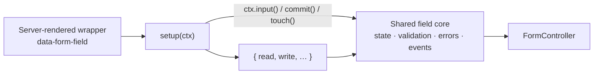

This guide builds an **image input with preview**. By the end you will know everything a custom field needs: markup, `defineField()`, the field context, values, registration and cleanup.

For the full API, see the [`defineField` reference](/reference/define-field/).

## How fields work

Every field sits inside a `[data-form-field]` wrapper. FormLayer picks a field type from `data-field-type` (registered with `registerFieldType()` or a form's `fieldsMap`), or uses the built-in `NativeField` for plain inputs, selects, textareas, checkbox and radio groups and file inputs.

A field type only answers two questions:

1. **How do I read and write the value?**
2. **When does the user change or leave the field?**

Everything else is shared and you don't write it: field state, `data-validate` rules, error rendering and `aria-invalid`, server errors, enabling and disabling (conditional fields), reset, and the events the form listens to.



## Step 1 — Markup

Render the full markup on the server. The file input stays in the DOM so the form works without JavaScript. Parts that only make sense with JavaScript start out `hidden`.

```html
<div data-form-field="avatar"
     data-field-type="image-preview"
     data-validate='[{"type":"NotEmpty","options":{"message":"Choose a profile photo."}},
                     {"type":"FileSize","options":{"maximum":"2M","message":"Choose an image under 2 MB."}}]'>
  <label for="avatar">Profile photo</label>
  <input id="avatar" type="file" name="avatar" accept="image/*">
  
  <button type="button" data-fl-part="clear" hidden>Remove photo</button>
  <p id="avatar-errors" class="invalid-feedback"></p>
</div>
```

| Attribute | Role |
|-----------|------|
| `data-form-field` | Field name. Server errors are matched by this name. |
| `data-field-type` | The registered field type to use |
| `data-validate` | JSON list of validator rules |
| `data-fl-part` | Marks elements your field looks up with `ctx.part()` |

The error container is found by convention: `#<input id>-errors`, or `.invalid-feedback` inside the wrapper. Don't reference it from `aria-describedby` in the markup; FormLayer adds the reference only while the field is invalid.

## Step 2 — Define the field

```typescript
// fields/image-preview.ts
import { defineField } from 'formlayer';

export default defineField({
  setup(ctx) {
    const input = ctx.control<HTMLInputElement>();
    const preview = ctx.part<HTMLImageElement>('preview');
    const clear = ctx.part<HTMLButtonElement>('clear');
    let url: string | null = null;

    const show = () => {
      if (url) URL.revokeObjectURL(url);
      const file = input.files?.[0];
      url = file ? URL.createObjectURL(file) : null;
      preview.src = url ?? '';
      preview.alt = file?.name ?? '';
      preview.hidden = clear.hidden = !file;
    };

    input.addEventListener('change', () => { show(); ctx.commit(); }, { signal: ctx.signal });
    clear.addEventListener('click', () => {
      input.value = '';
      show();
      ctx.commit();
      input.focus();
    }, { signal: ctx.signal });

    return {
      read: () => Array.from(input.files ?? []),
      write: (value) => { if (value.length === 0) { input.value = ''; show(); } },
      reset: () => { input.value = ''; show(); },
      destroy: () => { if (url) URL.revokeObjectURL(url); },
    };
  },
});
```

That is the whole field. `setup()` runs once per wrapper. It finds its elements, attaches listeners, tells FormLayer when the user changed something, and returns an **adapter** that reads and writes the value.

### The context (`ctx`)

| Member | Use it to |
|--------|-----------|
| `ctx.wrapper`, `ctx.name` | The `[data-form-field]` element and its name |
| `ctx.control()` | Get the first `input`/`select`/`textarea` in the wrapper |
| `ctx.part(name)` / `ctx.parts(name)` | Get the element(s) marked `data-fl-part="name"`. `part()` throws a clear error if it is missing |
| `ctx.setControl(el \| el[])` | Choose the element(s) that receive focus, `aria-invalid` and the error link. Default: the first control. Pass every option of a group |
| `ctx.signal` | Pass `{ signal: ctx.signal }` to every `addEventListener`; listeners are removed when the field is destroyed |
| `ctx.input()` | The user is typing. Marks the field dirty; validates after a short pause once the field was touched |
| `ctx.commit()` | The user committed a value (picked, ticked, selected, chose a file). Marks it dirty and touched and validates now |
| `ctx.touch()` | The user left the field. Marks it touched and validates |

These three signals mirror the DOM's `input`, `change` and `blur` events, and they are all a field needs to report. You never manage dirty/touched state, call validators or emit events yourself.

### The adapter

| Member | Required | Purpose |
|--------|----------|---------|
| `read()` | yes | Read the current value from the DOM |
| `write(value)` | yes | Write a value to the DOM (used by `setValue()`) |
| `focus()` | no | Focus the right element (default: the first control) |
| `reset()` | no | Restore the initial DOM state (default: `write()` the value read at setup) |
| `disabled(isDisabled)` | no | React to the field being disabled or enabled. Its controls are already toggled |
| `destroy()` | no | Remove DOM you created and free resources (object URLs, library instances) |

### Values

A value is a `FieldValue`: `string`, `string[]` or `File[]`. Return whatever fits the control, the way the native field does:

| Control | Value |
|---------|-------|
| Text, textarea, select, radio group, single checkbox | `string` |
| Checkbox group, multi-select | `string[]` |
| File input | `File[]` |

Validators receive the value as is. `NotEmpty` treats `''` and `[]` as empty, `Count` counts list items, `FileSize` and `MimeType` check `File[]`, and string validators see lists joined with commas. The submitted data always comes from the native controls in the form, not from `read()`.

## Step 3 — Register the field

Register globally before the forms initialise:

```typescript
import { registerFieldType, lazy } from 'formlayer';
import ImagePreviewField from './fields/image-preview';

registerFieldType('image-preview', ImagePreviewField);

// or load it only when a form uses it:
registerFieldType('image-preview', lazy(() => import('./fields/image-preview')));
```

Or per form, through `fieldsMap`:

```typescript
import { initTypo3Forms } from 'formlayer/typo3';
import { lazy } from 'formlayer';

initTypo3Forms({
  fieldsMap: {
    'image-preview': lazy(() => import('./fields/image-preview')),
  },
});
```

The module must `export default` the field.

## Building markup in JavaScript

Prefer server-rendered markup. When a field has to create elements (for example from data it loads), use the `html` template: it escapes every interpolated string, so labels from content editors or APIs can't inject markup.

```typescript
import { html } from 'formlayer';

const option = (country: { code: string; name: string; flag: string }) =>
  html`<li role="option" data-value="${country.code}"><span aria-hidden="true">${country.flag}</span> ${country.name}</li>`;

listbox.replaceChildren(...countries.map(option));
```

Interpolated nodes (and arrays of them) are inserted as nodes. `raw(markup)` inserts trusted markup unescaped; never pass user input to it.

## Server errors and conditional fields

Both work without extra code:

- After a failed submit, `FormController` calls `setServerErrors()` on each field. Errors stay until the value changes.
- Conditional fields ([client variants](/guides/plugins/#client-variants)) call `setEnabled(false)`. The core hides the wrapper, disables every control inside it, and skips validation. Re-enabling restores only what it disabled. Implement `disabled()` in the adapter if your field needs to react, for example by closing a popup.

## Standalone use

Fields also work without a form controller:

```typescript
import { initField, initFieldAsync, lazy } from 'formlayer';
import ImagePreviewField from './fields/image-preview';

const field = initField(document.querySelector('[data-form-field="avatar"]')!, {
  field: ImagePreviewField,
});
field.on('change', (state) => console.log(state.value, state.isValid));

// code-split:
const lazyField = await initFieldAsync(
  document.querySelector('[data-form-field="avatar"]')!,
  lazy(() => import('./fields/image-preview')),
);
```

## Migrating from `AbstractDomFormField`

`AbstractDomFormField` still works but is deprecated and will be removed in a later version. The mapping is direct:

| `AbstractDomFormField` | `defineField` |
|------------------------|---------------|
| `class X extends AbstractDomFormField` with `!` fields | `defineField({ setup(ctx) { … } })` with local variables |
| `mount()` | the body of `setup()` |
| `this.wrapper.querySelector(…)` | `ctx.part('name')`, `ctx.control()` |
| `setControlElement(el)` | `ctx.setControl(el)` |
| `readValue()` / `writeValue(value)` | `read()` / `write(value)` in the returned adapter |
| `focusControl()`, `onReset()`, `onDestroy()` | `focus()`, `reset()`, `destroy()` |
| `this.signal` | `ctx.signal` |
| `markDirty()` + `validate()` + `notifyChange()` while typing | `ctx.input()` |
| `markDirty()` + `markTouched()` + `setValue(v)` on selection | write the DOM, then `ctx.commit()` |
| `markTouched()` + `validate()` + `notifyChange()` on blur | `ctx.touch()` |

## Checklist

- [ ] The form works without JavaScript (native controls submit the value; JS-only parts start `hidden`)
- [ ] `read()` returns what validators and the backend expect
- [ ] Every listener uses `{ signal: ctx.signal }`
- [ ] User changes call `ctx.input()`, `ctx.commit()` or `ctx.touch()`
- [ ] `ctx.setControl()` points at the element(s) that should get focus and `aria-invalid`
- [ ] `destroy()` removes created nodes and frees resources
- [ ] The error container is found (`#id-errors` or `.invalid-feedback`)

## Next steps

- [`defineField` reference](/reference/define-field/): the complete API
- [Plugins](/guides/plugins/): register fields globally, lazy loading, built-in plugins
- [Error Rendering](/guides/error-rendering/): customise validation messages
